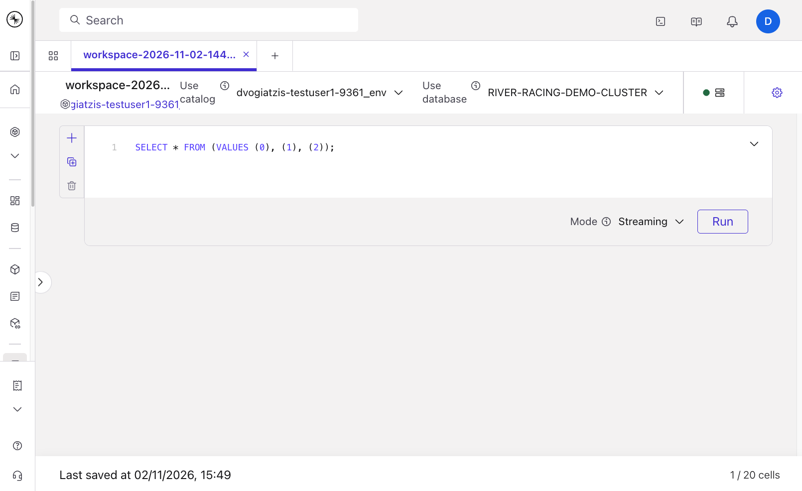

# Pre-provisioned workshop walkthrough

---
---
THIS A LONG README, MAYBE YOU WANT TO GO TO [https://dimi-vo.github.io/demo-confluent-intelligence-f1/#welcome](https://dimi-vo.github.io/demo-confluent-intelligence-f1/#welcome) INSTEAD.

---
---


Use this path when your organization's platform team has created a Confluent Cloud environment for you, made you its `EnvironmentAdmin`, and built the workshop inside it. You sign in with your own work account, connect to that environment as yourself, and run the race simulator on your machine.

**On the platform team?** The required infrastructure and resources are created with the [Terraform module](../../platform-team/README.md) in `platform-team/`.

**How to use this walkthrough.** Each step starts with what you'll learn and your task. Try the task yourself first:

- Open **💡 Hint** if you're stuck.
- Open **✅ Solution** to check your answer or copy the statement.
- **Learn more** links to the Confluent documentation.
- **🛠️ Troubleshooting** covers what can go wrong in that step.

## 0. Setup

Do 0.1 and 0.2 before the workshop day, and 0.3 and 0.4 at the start of the workshop.

### 0.1 Sign in to Confluent Cloud

**When:** one week before the workshop.

Sign in to the [Confluent Cloud Console](https://confluent.cloud) with your work email. With SSO, the Console sends you to your organization's sign-in page.

> [!IMPORTANT]
>
> This first sign-in registers your user account in your company's organization, so your platform team can provision the infrastructure for you.

### 0.2 Install the tools and clone the repository

**When:** a couple of days before the workshop.

You need three tools: Git, uv and the Confluent CLI.

**macOS**

```bash
brew install git uv
brew install --cask confluent-cli
```

<details>
<summary>Windows</summary>

```powershell
winget install --id Git.Git -e
winget install --id astral-sh.uv -e
```

The Confluent CLI has no reliable winget package. Download the latest `confluent_*_windows_amd64.zip` from the [Confluent CLI releases](https://github.com/confluentinc/cli/releases/latest), unzip it, and add the folder containing `confluent.exe` to your `PATH`. Then close and reopen the terminal so every tool is on your `PATH`.

</details>

Clone the workshop repository, and move into it:

```bash
git clone https://github.com/confluentinc/demo-confluent-intelligence-f1.git
cd demo-confluent-intelligence-f1
```

Run every `uv run` command in this walkthrough from this folder.

### 0.3 Explore your environment from the CLI

**When:** on the day of the workshop.

**What you'll learn:** how your environment, Kafka cluster and topics look from the Confluent CLI, and the difference between control-plane and data-plane operations.

1. Sign in to the Confluent CLI:

    ```bash
    confluent login
    ```

    Enter the email you used to sign in to Confluent Cloud.

2. List your environments:

    ```bash
    confluent environment list
    ```

    If you see several environments, select the one provided to you for the workshop, using its ID:

    ```bash
    confluent environment use env-abcd123
    ```

3. List the provisioned Kafka clusters:

    ```bash
    confluent kafka cluster list
    ```

    There should be just one in your environment. Set it as the default, using its ID:

    ```bash
    confluent kafka cluster use lkc-abcd123
    ```

4. List the provisioned topics:

    ```bash
    confluent kafka topic list
    ```

> [!NOTE]
>
> These are **control-plane** operations: they describe topics, clusters or environments. If you try to consume data from a topic, for example with `confluent kafka topic consume car_telemetry`, you'll see `Error: no API key selected for resource "lkc-abcd123"`. Consuming data is a **data-plane** operation, and it needs you to authenticate against the Kafka cluster. You create the API keys for that in the next step.

**Learn more**

- [Get Started with Confluent CLI](https://docs.confluent.io/confluent-cli/current/overview.html)
- [`confluent login`](https://docs.confluent.io/confluent-cli/current/command-reference/confluent_login.html)

### 0.4 Create your API keys

**When:** on the day of the workshop.

**What you'll learn:** which API keys the workshop tools need, and what each one is for.

Run the deploy:

```bash
uv run deploy --track pre-provisioned
```

It creates three API keys for your account:

1. A **Global API key**. The deploy uses it to create the other two keys, and the workshop tools use it for Flink and the Real-Time Context Engine.
2. A **Kafka API key**, which lets the race simulator and the Pit Wall dashboard read and write your topics.
3. A **Schema Registry API key**, which lets them read and register your topics' Avro schemas.

It writes them to your credential card, `runs/pre-provisioned/credentials/DEMO.env`.

New keys can take a minute or two to become active, so expect a couple of short waits. Before it finishes, the deploy checks that `driver_race_history` holds its 198 rows.

When it finishes, it prints a link to your Flink SQL workspace, your catalog and database, and the next steps. It then offers to start the Pit Wall dashboard in the background. You won't need the dashboard until section 3, so you can answer **n**.

Running the deploy again reuses your credential card while its keys still work, so it creates nothing new.

> [!IMPORTANT]
>
> Your Global key acts with all of your permissions, so keep the card private.

**Learn more**

- [Use API Keys to Authenticate to Confluent Cloud](https://docs.confluent.io/cloud/current/security/authenticate/workload-identities/service-accounts/api-keys/overview.html)

<details>
<summary>🛠️ Troubleshooting</summary>

- **`Error: Not logged into Confluent Cloud.`** Your Confluent CLI session is missing or has expired. Run `confluent login`, then the deploy again.
- **`Confluent Cloud refused a new Global key`.** Each account can hold 2 Global keys. Delete one you no longer use in the Console under **API keys** → **My account**, then run the deploy again.
- **`Your Global key sees no environment you're directly bound to.`** Ask your platform team for a direct `EnvironmentAdmin` role binding on your user. A binding through an SSO group mapping isn't enough, because API keys don't carry group-mapped permissions. If you belong to several Confluent Cloud organizations, the deploy lists them: run `confluent login --organization <id>` for the right one, then the deploy again.
- **`Your platform team hasn't provisioned <name> (<id>) yet`.** Send them the environment ID it names, and run the deploy again once they're done.
- **`driver_race_history holds N rows, expected 198`.** Ask your platform team to rebuild the table (their guide shows how), then run the deploy again.
- **A wait that times out, or `could not reach the Confluent Cloud API`.** Run the deploy again. A run that stops before writing your card deletes the keys it created, so retrying never uses up your Global-key slots.

</details>

## 1. Get familiar with Flink

### 1.1 The Flink SQL workspace

**What you'll learn:** what a Flink SQL workspace and a compute pool are, and how Kafka resources map to Flink catalogs, databases and tables.

A Flink SQL workspace is the browser-based SQL editor in the Confluent Cloud Console.

1. Go to the Confluent Cloud Console and open the [SQL workspaces](https://confluent.cloud/workspaces/) page, or use the navigation on the left side.

2. Click **Create new workspace**.

    <button style="background-color: #1668dc; color: white; border: 0; border-radius: 6px; padding: 10px 16px; font-size: 14px;"><span>Create new workspace</span></button>

    A workspace by itself doesn't incur any costs or run any Flink jobs. Flink jobs run on a compute pool, which represents the resources used to run them. Your platform team has provisioned the compute pool for you.

3. To simplify the statements later, select the default catalog and database for your workspace with the **Use catalog** and **Use database** dropdowns. Pick the ones the deploy printed: your environment (for example `John-Doe-c21e_env`) and `RIVER-RACING-DEMO-CLUSTER`.

    

> [!NOTE]
>
> Kafka resources are available in Flink by default. The mapping between Kafka and Flink resources is:
>
> | Kafka           | Flink     |
> |-----------------|-----------|
> | Environment     | Catalog   |
> | Cluster         | Database  |
> | Topic + Schema  | Table     |

**Learn more**

- [Flink SQL Quick Start with Confluent Cloud Console](https://docs.confluent.io/cloud/current/flink/get-started/quick-start-cloud-console.html#step-1-create-a-workspace)
- [Compute Pools](https://docs.confluent.io/cloud/current/flink/concepts/compute-pools.html)
- [Metadata mapping between Kafka and Flink](https://docs.confluent.io/cloud/current/flink/overview.html#metadata-mapping-between-ak-cluster-topics-schemas-and-af)

### 1.2 Data exploration

**What you'll learn:** how to inspect tables with `SHOW` and `DESCRIBE`, and what makes a query a streaming query.

Explore the pre-deployed source tables:

```sql
SHOW TABLES;
```

| Table                 | Source                                                        | Format  |
|-----------------------|---------------------------------------------------------------|---------|
| `car_telemetry`       | Race simulator — car #88 sensors, every 2s                    | Avro    |
| `race_standings`      | Race simulator — all 22 cars, keyed by `car_number` (upsert)  | Avro    |
| `driver_race_history` | 198 historical race rows seeded by your platform team         | Avro    |

Look at the columns of `driver_race_history`:

```sql
DESCRIBE `driver_race_history`;
```

Make sure that `driver_race_history` is populated. It should have 198 rows:

```sql
SELECT COUNT(*) FROM driver_race_history;
```

**Your task:** list the Grand Prix winners: the driver and the Grand Prix name of every row whose `finishing_pos` is 1.

<details>
<summary>✅ Solution</summary>

```sql
select driver, `gp_name` from `driver_race_history`
where `finishing_pos` = 1;
```

</details>

> [!NOTE]
>
> You'll notice that the two queries don't terminate: they stay in a **Running** state. That's because you created your first **streaming queries**. As data comes in, the results update in real time. You'll see this in action in the next section.

> [!IMPORTANT]
>
> Stop the query when you're done. A running query incurs costs. If you don't need one, stop it.

**Learn more**

- [SHOW Statements](https://docs.confluent.io/cloud/current/flink/reference/statements/show.html)
- [DESCRIBE Statement](https://docs.confluent.io/cloud/current/flink/reference/statements/describe.html)
- [Flink SQL Statements](https://docs.confluent.io/cloud/current/flink/concepts/statements.html)
- [Confluent Cloud for Apache Flink Billing](https://docs.confluent.io/cloud/current/flink/concepts/flink-billing.html)

## 2. Enrich the data with built-in ML functions

Your platform team set up the source tables `car_telemetry`, `race_standings` and `driver_race_history`.

In this section, you create a `car_state` table that joins telemetry with race standings over 20-second tumbling windows, and uses Confluent's built-in `ML_DETECT_ANOMALIES` function to flag abnormal front-left tire temperatures. You build it step by step: a join (2.2), a window aggregation (2.3), anomaly detection (2.4), and finally the table itself (2.5).

### 2.1 Start the race

Start the race simulator, so there's a flow of data coming in:

```bash
uv run f1-race
```

Leave it running.

Each lap takes 20 seconds and there are 60 laps, so the race completes after 20 minutes. Lap 1 starts on the next 20-second wall-clock boundary, so it can take up to 20 seconds to appear.

To restart the race, follow [Start from a clean slate](#start-from-a-clean-slate).

<details>
<summary>🛠️ Troubleshooting</summary>

- **`No credential card found` / `Multiple credential cards found`.** Pass `--creds runs/pre-provisioned/credentials/DEMO.env` or re-run `uv run deploy --track pre-provisioned` to refresh `F1_CARD` in `credentials.env`.

</details>

### 2.2 Join streams

**What you'll learn:** why a regular join is the wrong tool for enriching a stream, and how a temporal join relates each telemetry reading to the race standings that were valid at that moment.

In traditional SQL databases there's a whole family of join operations: inner and outer joins, left and right joins, and so on. Flink supports all of these classic SQL joins, but in most situations it's a mistake to use them in your Flink SQL applications. The reason has to do with what it means to execute a join in a streaming fashion.

Typically, two tables are related by having the primary key of one table present as a foreign key in another table. In our race data, each record in `race_standings` has a `car_number` column that is its primary key:

```sql
CREATE TABLE IF NOT EXISTS `race_standings` (
  `car_number` INT,
  -- ...
  -- ... the rest of the fields
  -- ...
  `event_time` TIMESTAMP(3),
  WATERMARK FOR `event_time` AS `event_time` - INTERVAL '10' SECOND,
  PRIMARY KEY (`car_number`) NOT ENFORCED -- 👈
) DISTRIBUTED BY (`car_number`) INTO 1 BUCKETS
WITH (
  'changelog.mode' = 'upsert'
  -- ... the rest of the options
);
```

The effect of setting up `race_standings` this way is that each new record in the standings stream replaces whatever was previously stored for that same car. It's `'changelog.mode' = 'upsert'` that makes `race_standings` an upsert table: Flink reads each record as an insert, or as an update of the row with the same primary key.

`car_telemetry`, on the other hand, is modeled differently. Sensor readings are immutable, so the stream is insert-only rather than updating, and there's no primary key. Here, `'changelog.mode' = 'append'` makes `car_telemetry` an append-only table: Flink reads every record as a new row, never as an update of an earlier one. Each reading has a foreign-key relationship to the car it belongs to:

```sql
CREATE TABLE `car_telemetry` (
  `car_number` INT,
  -- ... more sensor columns
  `event_time` TIMESTAMP(3),
  WATERMARK FOR `event_time` AS `event_time` - INTERVAL '5' SECOND
) WITH ('changelog.mode' = 'append');
```

This makes it possible to join telemetry to standings, which you might do to enrich each reading with race context. A regular join seems like a very natural way to do it:

```sql
SELECT
 t.car_number, 
 t.event_time, 
 t.lap,
 t.tire_temp_fl_c, t.tire_temp_fr_c, t.tire_temp_rl_c, t.tire_temp_rr_c,
 t.tire_pressure_fl_psi, t.tire_pressure_fr_psi, t.tire_pressure_rl_psi, t.tire_pressure_rr_psi,
 t.engine_temp_c, 
 t.brake_temp_fl_c, t.brake_temp_fr_c, 
 t.battery_charge_pct, 
 t.fuel_remaining_kg,
 r.`position`, 
 r.gap_to_ahead_sec, r.gap_to_leader_sec, 
 r.pit_stops, 
 r.tire_compound, 
 r.tire_age_laps
FROM `car_telemetry` t
JOIN `race_standings` r
 ON t.car_number = r.car_number
```

The output looks right, but **don't do this!** Stop the query.

> [!IMPORTANT]
>
> A regular inner join is not what you want for stream enrichment. It produces an updating table, so a later standings update can change or remove results that were already emitted. It also keeps both inputs in state forever.

**Your task:** rewrite the query as a *temporal join*, which enriches each telemetry reading with the standings of its car as of the reading's `event_time`.

<details>
<summary>💡 Hint</summary>

- A temporal join adds `FOR SYSTEM_TIME AS OF <time attribute>` after the versioned table, here `race_standings`. The time attribute is the telemetry reading's `t.event_time`.
- To make sure the query also sees standings written before it started, read `race_standings` from the earliest offset with an `OPTIONS` hint: `/*+ OPTIONS('scan.startup.mode'='earliest-offset') */`.

</details>

<details>
<summary>✅ Solution</summary>

```sql
SELECT
 t.car_number, 
 t.event_time, 
 t.lap,
 t.tire_temp_fl_c, t.tire_temp_fr_c, t.tire_temp_rl_c, t.tire_temp_rr_c,
 t.tire_pressure_fl_psi, t.tire_pressure_fr_psi, t.tire_pressure_rl_psi, t.tire_pressure_rr_psi,
 t.engine_temp_c, 
 t.brake_temp_fl_c, t.brake_temp_fr_c, 
 t.battery_charge_pct, 
 t.fuel_remaining_kg,
 r.`position`, 
 r.gap_to_ahead_sec, r.gap_to_leader_sec, 
 r.pit_stops, 
 r.tire_compound, 
 r.tire_age_laps
FROM `car_telemetry` t
JOIN `race_standings` 
 /*+ OPTIONS('scan.startup.mode'='earliest-offset') */ 
 FOR SYSTEM_TIME AS OF t.event_time AS r 
 ON t.car_number = r.car_number
```

This query relates each `car_telemetry` record to the most recent `race_standings` record for that car, as of the time of that reading (`t.event_time`). This is almost always what you really want. Compared to a regular inner join, a temporal join has a number of other advantages:

- The output stream is insert-only rather than updating, so you can apply any sort of further processing to it.
- The output stream has watermarks, so you aren't restricted in how you can operate on it. For example, you can apply windowing to it.
- The runtime doesn't have to store past telemetry readings.

There are some restrictions, however:

- The right-hand (versioned) table must be an updating table with a primary key. Here, `race_standings` is an upsert table keyed by `car_number`.
- The primary key of the versioned table must be used in the equivalence condition of the temporal join. Here, that's `t.car_number = r.car_number`.

In Confluent Cloud for Apache Flink, `$rowtime` is a system column equal to the Kafka record timestamp. You can instead use a column such as `event_time` for event-time operations, provided you declare it as a time attribute with a `WATERMARK` clause. The platform team already did this for both tables when they provisioned the resources (see [`statements.tf`](../../platform-team/modules/developer/statements.tf)).

The `OPTIONS` hint sets `scan.startup.mode` for this query only. With `earliest-offset`, Flink reads `race_standings` from the earliest available offset.

</details>

> [!IMPORTANT]
>
> Stop the query when you're done.

> [!NOTE]
>
> Watermarks are complex enough to need a session of their own, so this workshop doesn't go deeper into them. The two Confluent Developer modules under **Learn more** cover the watermarking strategy used in Apache Flink.

**Learn more**

- [Streaming JOINs in Flink SQL](https://developer.confluent.io/courses/flink-sql/streaming-joins/)
- [Event-time temporal joins](https://docs.confluent.io/cloud/current/flink/reference/queries/joins.html#event-time-temporal-joins)
- [Time and Watermarks](https://docs.confluent.io/cloud/current/flink/concepts/timely-stream-processing.html)
- [How streaming SQL uses watermarks](https://developer.confluent.io/courses/flink-sql/watermarks/) and [Exercise: Hands-on with watermarks](https://developer.confluent.io/courses/flink-sql/watermarks-exercise/)
- [The `$rowtime` system column](https://docs.confluent.io/cloud/current/flink/reference/statements/create-table.html#rowtime)
- [SQL Hints](https://docs.confluent.io/cloud/current/flink/reference/queries/hints.html)

### 2.3 Window aggregations

**What you'll learn:** how windowing functions split an infinite stream into finite windows, and how to aggregate each window.

Windows are central to processing infinite streams. Windows split the stream into "buckets" of finite size, over which you can apply computations.

Flink provides 4 built-in windowing functions: `TUMBLE`, `HOP`, `CUMULATE` and `SESSION`. Here's an example of the invocation of the `TUMBLE` function:

```sql
SELECT * FROM TABLE(TUMBLE(TABLE data, DESCRIPTOR(timecol), size))
```

The `TUMBLE` Table-Valued Function (TVF) returns the input columns plus `window_start`, `window_end`, and `window_time`.

For the purpose of this demo, every lap takes exactly 20 seconds.

**Your task:**

1. Use a window aggregation to calculate the average of every `car_telemetry` data point per lap.
2. Extend the query to include our driver's position in the race, which is paramount to developing our racing strategy. Use the result of the temporal join from 2.2 in this statement.

<details>
<summary>💡 Hint 1</summary>

- A lap takes exactly 20 seconds, so a 20-second tumbling window holds one lap: `TUMBLE(TABLE car_telemetry, DESCRIPTOR(event_time), INTERVAL '20' SECOND)`.
- Group by the window columns (`window_start`, `window_end`, `window_time`) and `car_number`.
- Average the telemetry columns.

</details>

<details>
<summary>✅ Solution 1: averages per lap</summary>

```sql
SELECT
  window_start, window_end, window_time, car_number, MAX(lap) AS lap,
  AVG(tire_temp_fl_c) AS tire_temp_fl_c, AVG(tire_temp_fr_c) AS tire_temp_fr_c,
  AVG(tire_temp_rl_c) AS tire_temp_rl_c, AVG(tire_temp_rr_c) AS tire_temp_rr_c,
  AVG(tire_pressure_fl_psi) AS tire_pressure_fl_psi, AVG(tire_pressure_fr_psi) AS tire_pressure_fr_psi,
  AVG(tire_pressure_rl_psi) AS tire_pressure_rl_psi, AVG(tire_pressure_rr_psi) AS tire_pressure_rr_psi,
  AVG(engine_temp_c) AS engine_temp_c, AVG(brake_temp_fl_c) AS brake_temp_fl_c, AVG(brake_temp_fr_c) AS brake_temp_fr_c,
  AVG(battery_charge_pct) AS battery_charge_pct, AVG(fuel_remaining_kg) AS fuel_remaining_kg
FROM TABLE(TUMBLE(TABLE car_telemetry, DESCRIPTOR(event_time), INTERVAL '20' SECOND))
GROUP BY window_start, window_end, window_time, car_number
```

</details>

<details>
<summary>💡 Hint 2</summary>

- Join first, then window: wrap the temporal join in a CTE (`WITH enriched AS (...)`) and pass `TABLE enriched` to `TUMBLE`.
- Keep the averages from part 1, and use `MAX()` for the race-standings columns (position, gaps, pit stops, tire compound and tire age).

</details>

<details>
<summary>✅ Solution 2: with the race position</summary>

```sql
WITH enriched AS (
      SELECT
        t.car_number, 
        t.event_time, 
        t.lap,
        t.tire_temp_fl_c, t.tire_temp_fr_c, t.tire_temp_rl_c, t.tire_temp_rr_c,
        t.tire_pressure_fl_psi, t.tire_pressure_fr_psi, t.tire_pressure_rl_psi, t.tire_pressure_rr_psi,
        t.engine_temp_c, 
        t.brake_temp_fl_c, t.brake_temp_fr_c, 
        t.battery_charge_pct, 
        t.fuel_remaining_kg,
        r.`position`, 
        r.gap_to_ahead_sec, r.gap_to_leader_sec, 
        r.pit_stops, 
        r.tire_compound, 
        r.tire_age_laps
      FROM `car_telemetry` t
      JOIN `race_standings` /*+ OPTIONS('scan.startup.mode'='earliest-offset') */ FOR SYSTEM_TIME AS OF t.event_time AS r ON t.car_number = r.car_number
    )
SELECT
  window_start, window_end, window_time, car_number, MAX(lap) AS lap,
  AVG(tire_temp_fl_c) AS tire_temp_fl_c, AVG(tire_temp_fr_c) AS tire_temp_fr_c,
  AVG(tire_temp_rl_c) AS tire_temp_rl_c, AVG(tire_temp_rr_c) AS tire_temp_rr_c,
  AVG(tire_pressure_fl_psi) AS tire_pressure_fl_psi, AVG(tire_pressure_fr_psi) AS tire_pressure_fr_psi,
  AVG(tire_pressure_rl_psi) AS tire_pressure_rl_psi, AVG(tire_pressure_rr_psi) AS tire_pressure_rr_psi,
  AVG(engine_temp_c) AS engine_temp_c, AVG(brake_temp_fl_c) AS brake_temp_fl_c, AVG(brake_temp_fr_c) AS brake_temp_fr_c,
  AVG(battery_charge_pct) AS battery_charge_pct, AVG(fuel_remaining_kg) AS fuel_remaining_kg,
  MAX(`position`) AS `position`, MAX(gap_to_ahead_sec) AS gap_to_ahead_sec, MAX(gap_to_leader_sec) AS gap_to_leader_sec,
  MAX(pit_stops) AS pit_stops, MAX(tire_compound) AS tire_compound, MAX(tire_age_laps) AS tire_age_laps
FROM TABLE(TUMBLE(TABLE enriched, DESCRIPTOR(event_time), INTERVAL '20' SECOND))
GROUP BY window_start, window_end, window_time, car_number
```

</details>

You now have a streaming query that produces, in real time, one row per lap with the car's average telemetry and our position in the race.

> [!IMPORTANT]
>
> Stop the query when you're done.

**Learn more**

- [Windowing Table-Valued Functions](https://docs.confluent.io/cloud/current/flink/reference/queries/window-tvf.html), with [examples for each function](https://docs.confluent.io/cloud/current/flink/reference/queries/window-tvf.html#examples)
- [Window Aggregation Queries](https://docs.confluent.io/cloud/current/flink/reference/queries/window-aggregation.html)

### 2.4 Detect anomalies with built-in ML

**What you'll learn:** how to run Confluent's built-in `ML_DETECT_ANOMALIES` function over an `OVER` window to flag outliers in a time series.

We now have a statement that gives us the position of our driver and the state of their car in real time. In this step, we use machine learning to spot anomalies in tire degradation.

Thankfully, we can use Flink's built-in ML functions. The `ML_DETECT_ANOMALIES` function uses an ARIMA model to identify outliers in our time-series data.

This is how you call the function:

```sql
ML_DETECT_ANOMALIES(value, timestamp [, config])
```

Pass it this configuration as `config`. The detector needs some history before it can flag anything: `'minTrainingSize' VALUE 12` makes it wait for 12 windows.

```sql
JSON_OBJECT(
  'minTrainingSize' VALUE 12,
  'maxTrainingSize' VALUE 50,
  'confidencePercentage' VALUE 99.99,
  'enableStl' VALUE FALSE
)
```

**Your task:** reuse the previous statement to spot anomalies in the **front-left tire temperature** (`tire_temp_fl_c`).

<details>
<summary>💡 Hint</summary>

- Wrap the window aggregation from 2.3 in a second CTE (for example `windowed`), and select from it.
- `ML_DETECT_ANOMALIES` runs over an `OVER` window. The `OVER` clause looks like this:

  ```sql
  OVER (
      PARTITION BY ...
      ORDER BY ...
      RANGE BETWEEN UNBOUNDED PRECEDING AND CURRENT ROW
  ) AS anomaly_tire_temp_fl_result
  ```

</details>

<details>
<summary>✅ Solution</summary>

```sql
WITH enriched AS (
SELECT
  t.car_number, 
  t.event_time, 
  t.lap,
  t.tire_temp_fl_c, t.tire_temp_fr_c, t.tire_temp_rl_c, t.tire_temp_rr_c,
  t.tire_pressure_fl_psi, t.tire_pressure_fr_psi, t.tire_pressure_rl_psi, t.tire_pressure_rr_psi,
  t.engine_temp_c, 
  t.brake_temp_fl_c, t.brake_temp_fr_c, 
  t.battery_charge_pct, 
  t.fuel_remaining_kg,
  r.`position`, 
  r.gap_to_ahead_sec, r.gap_to_leader_sec, 
  r.pit_stops, 
  r.tire_compound, 
  r.tire_age_laps
FROM `car_telemetry` t
JOIN `race_standings` /*+ OPTIONS('scan.startup.mode'='earliest-offset') */ FOR SYSTEM_TIME AS OF t.event_time AS r ON t.car_number = r.car_number
),
windowed AS (
SELECT
  window_start, window_end, window_time, car_number, MAX(lap) AS lap,
  AVG(tire_temp_fl_c) AS tire_temp_fl_c, AVG(tire_temp_fr_c) AS tire_temp_fr_c,
  AVG(tire_temp_rl_c) AS tire_temp_rl_c, AVG(tire_temp_rr_c) AS tire_temp_rr_c,
  AVG(tire_pressure_fl_psi) AS tire_pressure_fl_psi, AVG(tire_pressure_fr_psi) AS tire_pressure_fr_psi,
  AVG(tire_pressure_rl_psi) AS tire_pressure_rl_psi, AVG(tire_pressure_rr_psi) AS tire_pressure_rr_psi,
  AVG(engine_temp_c) AS engine_temp_c, AVG(brake_temp_fl_c) AS brake_temp_fl_c, AVG(brake_temp_fr_c) AS brake_temp_fr_c,
  AVG(battery_charge_pct) AS battery_charge_pct, AVG(fuel_remaining_kg) AS fuel_remaining_kg,
  MAX(`position`) AS `position`, MAX(gap_to_ahead_sec) AS gap_to_ahead_sec, MAX(gap_to_leader_sec) AS gap_to_leader_sec,
  MAX(pit_stops) AS pit_stops, MAX(tire_compound) AS tire_compound, MAX(tire_age_laps) AS tire_age_laps
FROM TABLE(TUMBLE(TABLE enriched, DESCRIPTOR(event_time), INTERVAL '20' SECOND))
GROUP BY window_start, window_end, window_time, car_number
)
SELECT *,
  ML_DETECT_ANOMALIES(
    tire_temp_fl_c, 
    window_time,
    JSON_OBJECT('minTrainingSize' VALUE 12, 'maxTrainingSize' VALUE 50, 'confidencePercentage' VALUE 99.99, 'enableStl' VALUE FALSE)
    )
  OVER (
    PARTITION BY car_number 
    ORDER BY window_time 
    RANGE BETWEEN UNBOUNDED PRECEDING AND CURRENT ROW) AS anomaly_tire_temp_fl_result
FROM windowed
```

The idea behind `OVER` windows in Flink SQL is that you can have a window that ends with the current row, and that stretches backwards through the history of the stream for a specific interval, measured either in time or by some number of rows.

The query above runs the anomaly detection per car, in ascending `window_time` order. In our case only one car collects telemetry, but the same query would work for a second car.

Here, `window_time` is the time attribute produced by the tumbling-window query. Together with `RANGE BETWEEN UNBOUNDED PRECEDING AND CURRENT ROW`, it gives the detector a cumulative frame for each car: from that car's earliest row through the current row, inclusive. So, as each new 20-second window arrives, the calculation considers that car's ordered history up to that point.

The result looks like this:

```text
timestamp,              actual_value, forecast_value, lower_bound, upper_bound, is_anomaly, rmse, aic
2026-11-03 09:47:39.99, 144.7,        104.9603881231, 104.3688855, 105.5518907, TRUE,       0.08, -8.1
```

</details>

> [!IMPORTANT]
>
> Stop the query when you're done.

**Learn more**

- [`ML_DETECT_ANOMALIES`](https://docs.confluent.io/cloud/current/flink/reference/functions/model-inference-functions.html#ml-detect-anomalies), one of the [built-in functions for ML and AI inference](https://docs.confluent.io/cloud/current/flink/reference/functions/model-inference-functions.html)
- [Detect Anomalies in Data](https://docs.confluent.io/cloud/current/ai/builtin-functions/detect-anomalies.html), including the [anomaly detection results](https://docs.confluent.io/cloud/current/ai/builtin-functions/detect-anomalies.html#anomaly-detection-results)
- [OVER Aggregation Queries](https://docs.confluent.io/cloud/current/flink/reference/queries/over-aggregation.html)
- [OVER aggregations](https://developer.confluent.io/courses/flink-sql/over-windows/) — Flink SQL course on Confluent Developer

### 2.5 Put it all together: create `car_state`

**What you'll learn:** how `CREATE TABLE ... AS SELECT` (CTAS) turns a query into a statement that runs continuously and writes its results to a new table.

Now combine the previous three steps into one statement that creates the `car_state` table. `car_state` holds one row per car (our team only has one car in this example) for every lap (one 20-second window).

The table has these columns. The telemetry values are averages over the lap.

- `car_number`: the car's number.
- `lap`: the lap number, starting at lap 1.
- `tire_temp_fl_c`, `tire_temp_fr_c`, `tire_temp_rl_c`, `tire_temp_rr_c`: the temperature of each tire (front-left, front-right, rear-left, rear-right), in °C.
- `tire_pressure_fl_psi`, `tire_pressure_fr_psi`, `tire_pressure_rl_psi`, `tire_pressure_rr_psi`: the pressure of each tire, in psi.
- `engine_temp_c`: the engine temperature, in °C.
- `brake_temp_fl_c`, `brake_temp_fr_c`: the temperature of each front brake, in °C.
- `battery_charge_pct`: the battery charge, in percent.
- `fuel_remaining_kg`: the fuel left in the car, in kg.
- `anomaly_tire_temp_fl`: `true` when `ML_DETECT_ANOMALIES` finds the front-left tire temperature higher than expected, otherwise `false`.
- `position`: the car's position in the race.
- `gap_to_ahead_sec`: the gap to the car ahead, in seconds.
- `gap_to_leader_sec`: the gap to the race leader, in seconds.
- `pit_stops`: the number of pit stops the car has made.
- `tire_compound`: the current tire compound, for example `SOFT`.
- `tire_age_laps`: how many laps the current tires have done.

The `CREATE TABLE` statement must also set two options in its `WITH` clause: `'changelog.mode' = '...'` and `'kafka.consumer.isolation-level' = 'read-uncommitted'`. Think about which mode `car_state` needs.

> [!IMPORTANT]
>
> Before you run the statement, reset the race: stop `f1-race` with Ctrl-C, stop the Pit Wall dashboard if it's running, and run `uv run reset`. Reset clears the topics, so `car_state` processes one clean race from lap 1.

**Your task:** put together everything you've built so far to create the `car_state` table.

<details>
<summary>✅ Solution</summary>

```sql
CREATE TABLE `car_state` WITH ('changelog.mode' = 'append', 'kafka.consumer.isolation-level' = 'read-uncommitted') AS
WITH enriched AS (
  SELECT
    t.car_number, 
    t.event_time, 
    t.lap,
    t.tire_temp_fl_c, t.tire_temp_fr_c, t.tire_temp_rl_c, t.tire_temp_rr_c,
    t.tire_pressure_fl_psi, t.tire_pressure_fr_psi, t.tire_pressure_rl_psi, t.tire_pressure_rr_psi,
    t.engine_temp_c, 
    t.brake_temp_fl_c, t.brake_temp_fr_c, 
    t.battery_charge_pct, 
    t.fuel_remaining_kg,
    r.`position`, 
    r.gap_to_ahead_sec, r.gap_to_leader_sec, 
    r.pit_stops, 
    r.tire_compound, 
    r.tire_age_laps
  FROM `car_telemetry` t
  JOIN `race_standings` /*+ OPTIONS('scan.startup.mode'='earliest-offset') */ FOR SYSTEM_TIME AS OF t.event_time AS r ON t.car_number = r.car_number
),
windowed AS (
  SELECT
    window_start, window_end, window_time, car_number, MAX(lap) AS lap,
    AVG(tire_temp_fl_c) AS tire_temp_fl_c, AVG(tire_temp_fr_c) AS tire_temp_fr_c,
    AVG(tire_temp_rl_c) AS tire_temp_rl_c, AVG(tire_temp_rr_c) AS tire_temp_rr_c,
    AVG(tire_pressure_fl_psi) AS tire_pressure_fl_psi, AVG(tire_pressure_fr_psi) AS tire_pressure_fr_psi,
    AVG(tire_pressure_rl_psi) AS tire_pressure_rl_psi, AVG(tire_pressure_rr_psi) AS tire_pressure_rr_psi,
    AVG(engine_temp_c) AS engine_temp_c, AVG(brake_temp_fl_c) AS brake_temp_fl_c, AVG(brake_temp_fr_c) AS brake_temp_fr_c,
    AVG(battery_charge_pct) AS battery_charge_pct, AVG(fuel_remaining_kg) AS fuel_remaining_kg,
    MAX(`position`) AS `position`, MAX(gap_to_ahead_sec) AS gap_to_ahead_sec, MAX(gap_to_leader_sec) AS gap_to_leader_sec,
    MAX(pit_stops) AS pit_stops, MAX(tire_compound) AS tire_compound, MAX(tire_age_laps) AS tire_age_laps
  FROM TABLE(TUMBLE(TABLE enriched, DESCRIPTOR(event_time), INTERVAL '20' SECOND))
  GROUP BY window_start, window_end, window_time, car_number
),
anomaly AS (
  SELECT *,
    ML_DETECT_ANOMALIES(tire_temp_fl_c, window_time,
      JSON_OBJECT('minTrainingSize' VALUE 12, 'maxTrainingSize' VALUE 50, 'confidencePercentage' VALUE 99.99, 'enableStl' VALUE FALSE))
      OVER (PARTITION BY car_number ORDER BY window_time RANGE BETWEEN UNBOUNDED PRECEDING AND CURRENT ROW) AS anomaly_tire_temp_fl_result
  FROM windowed
)
SELECT
  car_number, lap,
  tire_temp_fl_c, tire_temp_fr_c, tire_temp_rl_c, tire_temp_rr_c,
  tire_pressure_fl_psi, tire_pressure_fr_psi, tire_pressure_rl_psi, tire_pressure_rr_psi,
  engine_temp_c, brake_temp_fl_c, brake_temp_fr_c, battery_charge_pct, fuel_remaining_kg,
  CASE
    WHEN anomaly_tire_temp_fl_result.is_anomaly AND anomaly_tire_temp_fl_result.actual_value > anomaly_tire_temp_fl_result.upper_bound THEN true
    ELSE false
  END AS anomaly_tire_temp_fl,
  `position`, gap_to_ahead_sec, gap_to_leader_sec, pit_stops, tire_compound, tire_age_laps
FROM anomaly
WHERE lap > 0;
```

The `WITH` options shape the new table:

- `'changelog.mode' = 'append'` makes `car_state` an insert-only stream.
- `'kafka.consumer.isolation-level' = 'read-uncommitted'` lets statements that read `car_state`, such as `pit_decisions` in section 4, see each row as soon as it's written instead of waiting for its transaction to commit.

</details>

> [!IMPORTANT]
>
> **Leave this statement running**, and wait until it shows **Running**. Then continue with [section 3](#3-start-the-race).

**Learn more**

- [CREATE TABLE AS SELECT (CTAS)](https://docs.confluent.io/cloud/current/flink/reference/statements/create-table.html#create-table-as-select-ctas)
- [The `kafka.consumer.isolation-level` option](https://docs.confluent.io/cloud/current/flink/reference/statements/create-table.html#kafka-consumer-isolation-level)
- [Monitor and Manage Flink SQL Statements](https://docs.confluent.io/cloud/current/flink/operate-and-deploy/monitor-statements.html)

## 3. Start the race

With `car_state` running, start the race again and watch the car's state build up lap by lap.

> [!NOTE]
>
> If at any point the data looks wrong or your queries return nothing, for example after the race restarted, follow [Start from a clean slate](#start-from-a-clean-slate).

### 3.1 Start the race and open the Pit Wall

1. Start the Pit Wall dashboard, and leave it running:

    ```bash
    uv run f1-pitwall
    ```

2. In a second terminal, start the race, and leave it running:

    ```bash
    uv run f1-race
    ```

3. Open [localhost:8000](http://localhost:8000).

The dashboard shows the Silverstone track map, the live leaderboard, and car #88's tire and fuel gauges. The **Anomaly Detection** panel unlocks as `car_state` emits rows, and the **AI Pit Strategist** panel unlocks once you create `pit_decisions` in section 4.


### 3.2 Watch `car_state` fill up

**What you'll learn:** how `car_state` evolves lap by lap, and when the anomaly detector has enough history to flag a spike.

`car_state` emits one row per 20-second window. After 12 windows (about 4 minutes), it has enough history to detect temperature anomalies on the front-left tire. At lap 24, the tire spikes to about 145°C and `anomaly_tire_temp_fl` becomes `true`.

Verify that `car_state` is filling up:

```sql
SELECT car_number, lap, `position`, tire_compound, tire_age_laps, anomaly_tire_temp_fl, tire_temp_fl_c
FROM `car_state`;
```

> [!IMPORTANT]
>
> Stop the query when you're done. The `car_state` statement keeps running.

<details>
<summary>🛠️ Troubleshooting</summary>

- **`car_state` is empty at first.** `car_state` emits one row per 20-second window, and `f1-race` aligns lap 1 to the next 20-second wall-clock boundary before starting. Make sure `car_state` is **Running** before starting `uv run f1-race`.
- **No anomaly around lap 24.** `ML_DETECT_ANOMALIES` needs 12 windows of context (`minTrainingSize = 12`) before lap 24. If `car_state` was started mid-race after lap 12, reset and start `car_state` before `uv run f1-race`.

</details>

## 4. Create a strategy using Streaming Agents

In this section, you deploy a Streaming Agent that uses the `car_state` information to define our strategy.

Our `pit_strategy_agent` evaluates the car's condition and the race context on every lap, and recommends one of:

- `STAY OUT`
- `PIT SOON`
- `PIT NOW`

### 4.1 The model

**What you'll learn:** which models your Flink statements can call for inference.

You can use your own external model for inference. In this workshop, we use a Confluent-hosted model that your platform team created for you.

List the available models:

```sql
SHOW MODELS;
```

We'll use `llm_textgen_model`.

**Learn more**

- [Run External Model Inference](https://docs.confluent.io/cloud/current/ai/ai-model-inference.html)
- [CREATE MODEL Statement](https://docs.confluent.io/cloud/current/flink/reference/statements/create-model.html)

### 4.2 The agent

**What you'll learn:** how `CREATE AGENT` combines a model and a prompt into a Streaming Agent you can call from Flink SQL.

The syntax is fairly simple:

```sql
CREATE AGENT `agent_name`
USING MODEL `llm_textgen_model`
USING PROMPT 'Your prompt';
```

**Your task:** create the `pit_strategy_agent`. Its prompt is long, so copy the statement from the solution.

<details>
<summary>✅ Solution</summary>

```sql
CREATE AGENT `pit_strategy_agent`
USING MODEL `llm_textgen_model`
USING PROMPT 'OUTPUT FORMAT — respond with exactly these 7 labeled lines in this order. Plain text only, no markdown or bold.

Suggestion: [PIT NOW | PIT SOON | STAY OUT]
Condition Summary: [one sentence describing current car condition]
Race Context: [one sentence on race situation]
Recommended Compound: [SOFT | MEDIUM | HARD | N/A if STAY OUT]
Recommended Stint Laps: [integer expected laps on new tires | N/A if STAY OUT]
Recommended Reason: [one sentence explaining compound choice | N/A if STAY OUT]
Reasoning: [2-4 sentences full explanation of your decision]

Correct STAY OUT example:
Suggestion: STAY OUT
Condition Summary: Front-left tire temperature is nominal at 107C with 18 laps of age on SOFT compound.
Race Context: Currently P3. Leader is 8.2s ahead.
Recommended Compound: N/A
Recommended Stint Laps: N/A
Recommended Reason: N/A
Reasoning: No anomaly has been detected, so tire temps and pressures are within normal operating windows for this stage of the stint. Track position P3 is strong and pitting now would surrender 4-6 seconds.

Correct PIT NOW example:
Suggestion: PIT NOW
Condition Summary: Front-left tire temperature anomaly at 145C, 20C above expected upper bound — failure risk imminent.
Race Context: Currently P8 with 36 laps remaining.
Recommended Compound: MEDIUM
Recommended Stint Laps: 36
Recommended Reason: Mediums will carry John to the flag across the remaining 36 laps and give him the pace to recover positions lost during the stop.
Reasoning: The FL anomaly flag indicates the SOFT has gone past its operating limit with blowout risk. Pitting now onto mediums avoids tire failure. Based on historical data, John averages +2.75 positions on SOFT-MEDIUM — this is his strongest strategy.

---

You are the AI pit wall strategist for River Racing at the 2026 British Grand Prix (Silverstone, 60 laps). Driver: John Doe, Car #88.

DECISION FRAMEWORK — weigh these in priority order:
1. Anomaly signal: anomaly_tire_temp_fl comes from a trained statistical anomaly detector (ML_DETECT_ANOMALIES) that evaluates tire_temp_fl_c against expected bounds. PIT NOW is reserved for this signal being true — treat it as validated evidence of a real tire problem requiring an immediate stop. When it is false, a raw temperature reading that merely looks high is still within expected bounds for the stint. Nothing else in this input — not tire age, not race context, not competitor behavior — should produce PIT NOW; those inform PIT SOON or STAY OUT instead.
2. Pit history: a car that has already pitted this race should usually stay out and run its current tires to the end, absent a new anomaly.
3. Tire age and compound: a SOFT tire past ~20 laps enters its strategic pit window. Call PIT SOON (never PIT NOW) throughout this window when no anomaly is flagged.
4. Otherwise: default to STAY OUT.

STRICT OUTPUT VALUES — the Suggestion line must be the exact literal string PIT NOW, PIT SOON, or STAY OUT with no extra text. For STAY OUT, write N/A for Recommended Compound, Recommended Stint Laps, and Recommended Reason.

TIRE STRATEGY at Silverstone (60-lap race):
- SOFT: Optimal laps 1-19; degrades in laps 20-22 (PIT SOON window), no failure risk unless the anomaly sensor fires.
- MEDIUM: Best for a 30-40 lap second stint after SOFT (clean 1-stop).
- HARD: Durable but slow; only for 40+ lap stints.
- John Doe historical best: SOFT -> MEDIUM 1-stop averages +2.75 positions over 4 prior races.'
WITH ('max_iterations' = '10');
```

The prompt has three parts:

- **Output format:** seven labeled lines, which `pit_decisions` parses into columns in the next step, with an example of a correct `STAY OUT` and a correct `PIT NOW` answer.
- **Role and decision framework:** the agent is River Racing's pit wall strategist, and it reserves `PIT NOW` for the anomaly flag.
- **Tire strategy** for the 60-lap race at Silverstone, including John Doe's historical best strategy.

`'max_iterations' = '10'` caps how many times the agent can call tools while it answers.

</details>

Confirm that the agent is registered:

```sql
SHOW AGENTS;
```

**Learn more**

- [Streaming Agents with Confluent Intelligence](https://docs.confluent.io/cloud/current/ai/streaming-agents/overview.html)
- [CREATE AGENT Statement](https://docs.confluent.io/cloud/current/flink/reference/statements/create-agent.html)

### 4.3 Create the strategy table

**What you'll learn:** how `AI_RUN_AGENT` calls an agent for every row of a stream, and how to parse the agent's text answer into columns.

The `pit_decisions` table invokes `pit_strategy_agent` on every row of `car_state` using `AI_RUN_AGENT`, and parses the structured fields out of its answer.

A simplified version of the statement looks like this:

```sql
CREATE TABLE `final_table_name` AS
SELECT
  table_name_values,
  CAST(response AS STRING) AS raw_response_by_the_agent
FROM `car_state` cs,
LATERAL TABLE(AI_RUN_AGENT(
  `agent_name`,
  'Prompt for the agent'
));
```

The real statement needs a lot of string concatenation to build the agent's input, but functionally it does the same thing.

**Your task:** create the `pit_decisions` table. Copy the statement from the solution.

<details>
<summary>✅ Solution</summary>

```sql
CREATE TABLE `pit_decisions` WITH ('changelog.mode' = 'append', 'kafka.consumer.isolation-level' = 'read-uncommitted') AS
SELECT
  cs.car_number, cs.lap, cs.`position`,
  cs.tire_compound AS tire_compound_current, cs.tire_age_laps, cs.anomaly_tire_temp_fl,
  TRIM(REGEXP_EXTRACT(CAST(response AS STRING), '\*{0,2}Suggestion:\*{0,2}\s*([^\n]+)', 1)) AS suggestion,
  TRIM(REGEXP_EXTRACT(CAST(response AS STRING), '\*{0,2}Condition Summary:\*{0,2}\s*([^\n]+)', 1)) AS condition_summary,
  TRIM(REGEXP_EXTRACT(CAST(response AS STRING), '\*{0,2}Race Context:\*{0,2}\s*([^\n]+)', 1)) AS race_context,
  NULLIF(TRIM(REGEXP_EXTRACT(CAST(response AS STRING), '\*{0,2}Recommended Compound:\*{0,2}\s*([^\n]+)', 1)), 'N/A') AS recommended_tire_compound,
  CAST(NULLIF(TRIM(REGEXP_EXTRACT(CAST(response AS STRING), '\*{0,2}Recommended Stint Laps:\*{0,2}\s*([^\n]+)', 1)), 'N/A') AS INT) AS recommended_stint_laps,
  NULLIF(TRIM(REGEXP_EXTRACT(CAST(response AS STRING), '\*{0,2}Recommended Reason:\*{0,2}\s*([^\n]+)', 1)), 'N/A') AS recommended_reason,
  TRIM(REGEXP_EXTRACT(CAST(response AS STRING), '\*{0,2}Reasoning:\*{0,2}\s*([\s\S]+?)$', 1)) AS reasoning,
  CAST(response AS STRING) AS raw_response
FROM `car_state` /*+ OPTIONS('scan.startup.mode'='earliest-offset') */ cs,
LATERAL TABLE(AI_RUN_AGENT(
  `pit_strategy_agent`,
  CONCAT(
    'CAR STATE — Lap ', CAST(cs.lap AS STRING), ' of 60 | Silverstone British Grand Prix\n',
    'Driver: John Doe (#', CAST(cs.car_number AS STRING), ') | Current Position: P', CAST(cs.`position` AS STRING), '\n',
    '\nTIRE DATA:\n',
    '  Compound: ', cs.tire_compound, ' | Age: ', CAST(cs.tire_age_laps AS STRING), ' laps\n',
    '  FL Temp: ', CAST(ROUND(cs.tire_temp_fl_c, 1) AS STRING), 'C  FR: ', CAST(ROUND(cs.tire_temp_fr_c, 1) AS STRING), 'C  RL: ', CAST(ROUND(cs.tire_temp_rl_c, 1) AS STRING), 'C  RR: ', CAST(ROUND(cs.tire_temp_rr_c, 1) AS STRING), 'C\n',
    '  FL Pressure: ', CAST(ROUND(cs.tire_pressure_fl_psi, 1) AS STRING), 'psi  FR: ', CAST(ROUND(cs.tire_pressure_fr_psi, 1) AS STRING), 'psi  RL: ', CAST(ROUND(cs.tire_pressure_rl_psi, 1) AS STRING), 'psi  RR: ', CAST(ROUND(cs.tire_pressure_rr_psi, 1) AS STRING), 'psi\n',
    '  FL Tire Anomaly Detected: ', CAST(cs.anomaly_tire_temp_fl AS STRING), '\n',
    '\nCAR SYSTEMS:\n',
    '  Engine Temp: ', CAST(ROUND(cs.engine_temp_c, 1) AS STRING), 'C  Brake FL: ', CAST(ROUND(cs.brake_temp_fl_c, 1) AS STRING), 'C  Brake FR: ', CAST(ROUND(cs.brake_temp_fr_c, 1) AS STRING), 'C\n',
    '  Battery: ', CAST(ROUND(cs.battery_charge_pct, 1) AS STRING), '%  Fuel Remaining: ', CAST(ROUND(cs.fuel_remaining_kg, 1) AS STRING), 'kg\n',
    '\nRACE CONTEXT:\n',
    '  Gap to Leader: ', CAST(ROUND(cs.gap_to_leader_sec, 2) AS STRING), 's  Gap to Car Ahead: ', CAST(ROUND(cs.gap_to_ahead_sec, 2) AS STRING), 's\n',
    '  Pit Stops Taken: ', CAST(cs.pit_stops AS STRING), '\n',
    '  Laps Remaining: ', CAST(60 - cs.lap AS STRING)
  ),
  MAP['debug', 'true']
));
```

</details>

> [!IMPORTANT]
>
> **Leave this statement running.**

**Learn more**

- [`AI_RUN_AGENT`](https://docs.confluent.io/cloud/current/flink/reference/functions/model-inference-functions.html#ai-run-agent)
- [Create and Run Streaming Agents](https://docs.confluent.io/cloud/current/ai/streaming-agents/create-and-run-streaming-agents.html)
- [Debug Streaming Agents](https://docs.confluent.io/cloud/current/ai/streaming-agents/debug-streaming-agents.html)

### 4.4 Watch the agent's decisions

**What you'll learn:** how to read the agent's lap-by-lap recommendations, including its call on the lap 24 anomaly.

Because the `pit_decisions` statement reads `car_state` from `earliest-offset`, it also processes the laps that have already arrived, so the Pit Wall shows the agent's decisions for the previous laps too.

Query `pit_decisions` to see the streaming recommendations:

```sql
SELECT lap, `position`, suggestion, condition_summary, reasoning
FROM `pit_decisions`;
```

Filter for the tire temperature anomaly to inspect the lap 24 pit call:

```sql
SELECT lap, `position`, tire_compound_current, tire_age_laps, anomaly_tire_temp_fl,
        suggestion, recommended_tire_compound, recommended_stint_laps, reasoning
FROM `pit_decisions`
WHERE anomaly_tire_temp_fl = true;
```


> [!IMPORTANT]
>
> Stop these queries when you're done. The `pit_decisions` statement keeps running.

<details>
<summary>🛠️ Troubleshooting</summary>

- **The agent's fields are null.** Inspect `SELECT lap, suggestion, raw_response FROM pit_decisions LIMIT 5;`. If `raw_response` is empty across the board, the agent's Confluent-hosted model isn't answering: ask your platform team to check that it's offered in your organization's region.

</details>

## 5. Expose `car_telemetry` to AI agents with Real-Time Context Engine

Real-Time Context Engine (RTCE) exposes a Kafka topic as an MCP tool, so any MCP-compatible AI agent can query the live stream.

### 5.1 Enable RTCE on `car_telemetry`

**What you'll learn:** how to make a topic available to AI agents through the Real-Time Context Engine.

You enable RTCE **per topic in the Console**. Under your environment's cluster, open **[Topics](https://confluent.cloud/go/topics) → `car_telemetry`**, open the **Real-Time Context Engine** panel, and click **Enable** (or **Turn on**). Once it's enabled, the **Topics** list shows Real-Time Context Engine **On**:


The panel displays the enablement details (environment, cluster, cloud and region) that an MCP client uses to reach it:


You can enable RTCE on `car_state` and `pit_decisions` the same way. You'll need them in [section 6](#6-create-a-social-media-agent) and [section 7](#7-analyze-race-data-with-lightning-queries).

**Learn more**

- [Real-Time Context Engine](https://docs.confluent.io/cloud/current/ai/real-time-context-engine/overview.html)

### 5.2 Connect your coding agent

Point your coding agent at RTCE in one command:

```bash
uv run setup-rtce
```

It asks which coding agent you use (Claude Code, Codex CLI, GitHub Copilot in VS Code or GitHub Copilot CLI) and registers RTCE as an MCP server with it, using the `F1_RTCE_MCP_ENDPOINT`, `F1_RTCE_API_KEY`, and `F1_RTCE_API_SECRET` fields on your credential card. The RTCE key on your card is the Global key your deploy created, so `uv run setup-rtce` doesn't ask for another one.

Restart your coding agent.

### 5.3 Ask questions in plain English

**What you'll learn:** how an AI agent answers questions about a live stream by calling the Real-Time Context Engine.

Ask your coding agent:

```text
What topics do I have access to in the Real-Time Context Engine?
```


```text
How has the engine temperature been trending over the last few laps?
```


```text
What's the front-left tire temperature on car 88 right now?
```


```text
At what lap in the race does the engine temperature peak?
```

```text
What is the front right tire temperature at lap 30?
```

## 6. Create a social media agent

In this section, you switch roles and join River Racing's social media team. Your coding agent already reads the live race data through RTCE. Now you use it to write social media posts.

### 6.1 Draft a post from live race data

**What you'll learn:** how to ground an AI agent's output in live race data through the Real-Time Context Engine.

> [!NOTE]
>
> Give your persona prompt and post requests to the coding agent you connected to RTCE in 5.2, for example Claude Code, Codex CLI or GitHub Copilot. That agent has the Real-Time Context Engine tools, so it can query the live topics. Another chatbot can't.

**Your task:**

1. Enable RTCE on the `car_state` and `pit_decisions` topics, the same way you enabled `car_telemetry` in 5.1.
2. Write a persona prompt that tells your agent how to write engaging social media posts for River Racing.
3. Ask your agent to draft a post from the live race data.

You can use one of these prompts to ask for a post:

- "We just made a big move — write a post celebrating it."
- "The pit wall just made a call. Draft a post about our strategy."
- "Write a 3-tweet recap thread of John's race so far."

<details>
<summary>✅ Solution</summary>

Here's an example persona prompt. Paste it into your agent, then ask for a post with one of the prompts above.

```text
You are the social-media manager for the River Racing Formula 1 team. Our driver
is John Doe (car #88) racing the British Grand Prix at Silverstone (60 laps).

Your job: when asked, draft short, high-energy social posts about what is
happening in OUR race, grounded in live data.

DATA
- Before writing, use the Real-Time Context Engine to query the car_state and
  pit_decisions topics for the latest laps. Never invent positions, gaps, lap
  numbers, or events — use only what the queries return.
- car_state has one row per lap: position, gaps, tire compound and age, and
  anomaly_tire_temp_fl, the front-left tire anomaly flag.
- pit_decisions has the pit wall's call for each lap (suggestion: PIT NOW,
  PIT SOON or STAY OUT) and its reasoning. PIT NOW or PIT SOON is newsworthy —
  say so.
- If the topics have no recent laps, say the race feed is quiet rather than
  making something up.

VOICE
- Confident, upbeat, fan-facing. Short sentences. 1–3 emoji max.
- Always third person about the team ("We", "John", "the #88").
- Under 280 characters unless the user asks for a longer recap.
- End with 2–3 hashtags from: #RiverRacing #JohnDoe #F1 #BritishGP #Silverstone
- Never disparage other teams or drivers.

OUTPUT
- Draft the post text only. Do not claim to have published it — these are drafts
  for a human to review and post.
```

</details>

To check the result, look at the transcript: your agent should call `queryData` on `car_state` and `pit_decisions`. The post should cite the real lap number, position and strategy call from your live race, not invented numbers.

<details>
<summary>🛠️ Troubleshooting</summary>

- **The agent says the feed is quiet.** The race may not be running yet, or RTCE isn't enabled on one of the two topics.

</details>

## 7. Analyze race data with Lightning Queries

Lightning Queries run SQL against an RTCE-enabled topic over a low-latency REST API.

### 7.1 Query `pit_decisions` with SQL over REST

**What you'll learn:** how Lightning Tables and Lightning Queries make real-time context queryable with SQL.

Print a ready-to-run query against `car_telemetry`, which you enabled in 5.1:

```bash
uv run setup-rtce --lightning
```

Copy the printed `curl` command into your terminal and run it. It returns the 10 most recent telemetry rows. You can edit the SQL in its `query` field to filter for car 88 or select other columns.

**Your task:** make sure RTCE is enabled on `pit_decisions` (you did this in 6.1). Then edit the `query` in the `curl` command to find out which tire compound the agent recommended on lap 24, and why:

```sql
SELECT lap, <column>, <column> FROM pit_decisions WHERE lap = 24 LIMIT 1
```

Fill in the first `<column>` with the recommended tire compound, and the second with the agent's reasoning for that call.

<details>
<summary>💡 Hint</summary>

The column names are the aliases in the `CREATE TABLE pit_decisions` statement from 4.3. Look for the `AS ...` after the expressions that extract **Recommended Compound** and **Reasoning**.

</details>

<details>
<summary>✅ Solution</summary>

```sql
SELECT lap, recommended_tire_compound, reasoning FROM pit_decisions WHERE lap = 24 LIMIT 1
```

</details>

**Learn more**

- [Lightning Tables](https://docs.confluent.io/cloud/current/lightning-tables/overview.html)
- [Query a Lightning Table with the API](https://docs.confluent.io/cloud/current/lightning-tables/query/api.html)

## Run the workshop again or tear it down

Stop `f1-race` with Ctrl-C when you finish.

### Start from a clean slate

Use this when you want to erase the race history and repeat the workshop, or when the data looks wrong or your queries return nothing, for example after the race restarted.

1. Stop `f1-race` with Ctrl-C.
2. Stop the Pit Wall dashboard (`f1-pitwall`, on port `8000`): press Ctrl-C in its terminal, or, if the deploy started it in the background, run the `kill` command the deploy printed.
3. Reset:

    ```bash
    uv run reset
    ```

    It stops your Flink statements, drops `car_state`, `pit_strategy_agent` and `pit_decisions`, and clears the race data from the source topics.

4. If you had created `car_state`, recreate it ([2.5](#25-put-it-all-together-create-car_state)) and wait for it to show **Running**. Recreate `pit_strategy_agent` and `pit_decisions` (section 4) too if you had built them.

    Alternatively, run `uv run reset --with-labs` in step 3: it rebuilds `car_state`, `pit_strategy_agent` and `pit_decisions` for you.

5. Start the Pit Wall dashboard:

    ```bash
    uv run f1-pitwall
    ```

6. In a second terminal, start the race, and leave it running:

    ```bash
    uv run f1-race
    ```

7. Open [localhost:8000](http://localhost:8000).

<details>
<summary>🛠️ Troubleshooting</summary>

- **`uv run reset` asks you to sign in.** It uses your Confluent CLI session from [0.3](#03-explore-your-environment-from-the-cli). If that session has expired, it asks you to sign in; with SSO, press **Enter** at the email prompt and accept the single sign-on login.

</details>

### Tear it down

When you're done with the workshop, run:

```bash
uv run destroy
```

It deletes the three API keys the deploy created for you, Global key last, and your credential card. Your environment and everything in it stay: they belong to your platform team, who delete them afterwards. Before it asks you to confirm, it lists the keys and tells you that your environment stays. Afterwards, it asks whether to delete `credentials.env` too (default **yes**).

<details>
<summary>🛠️ Troubleshooting</summary>

- **`uv run destroy` stopped partway.** Run it again: it deletes only what's left.
- **Your credential card is gone, or its Global key no longer works.** `uv run destroy` lists the keys for you to delete in the Console under **API keys** → **My account**.

</details>

---

**← Back to Overview**: [Main README](../../README.md)
